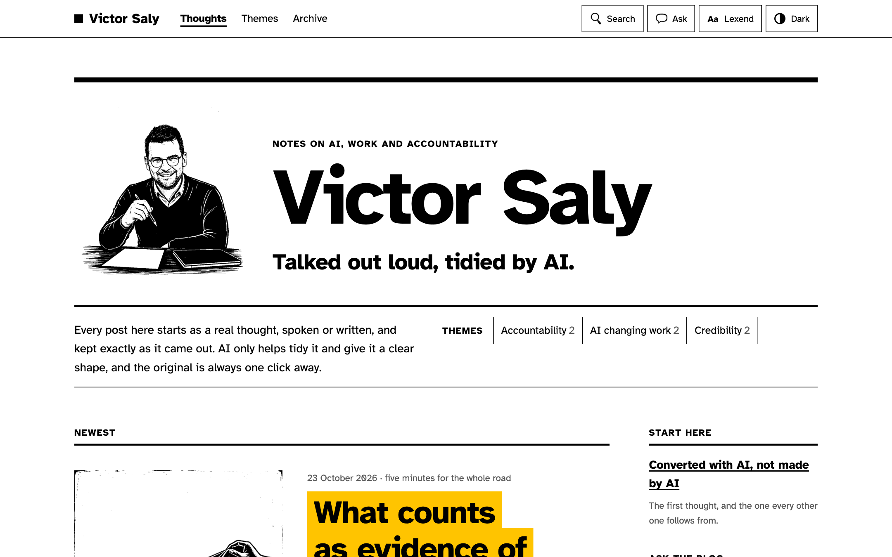
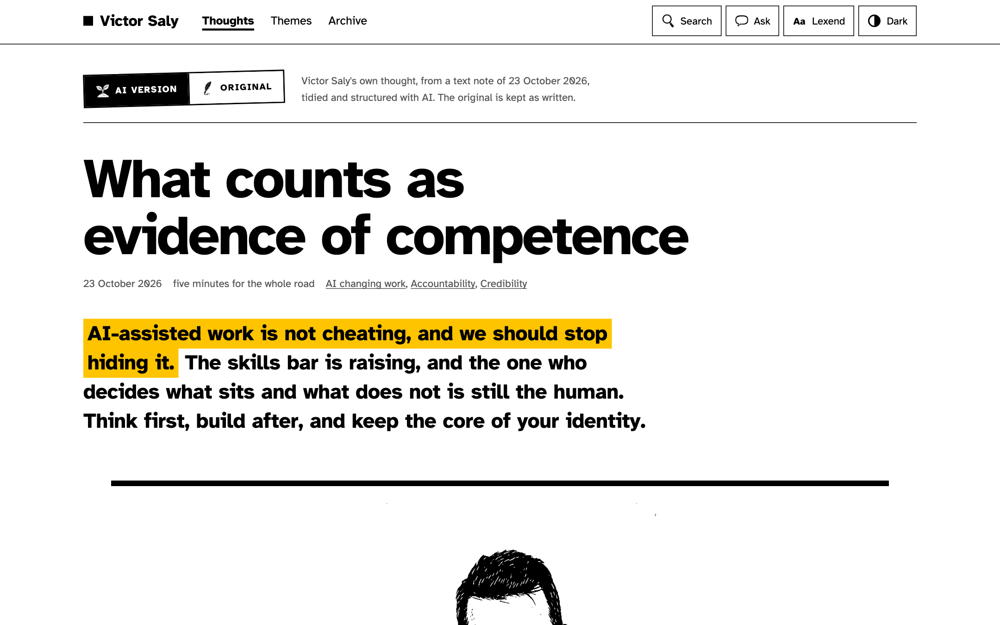
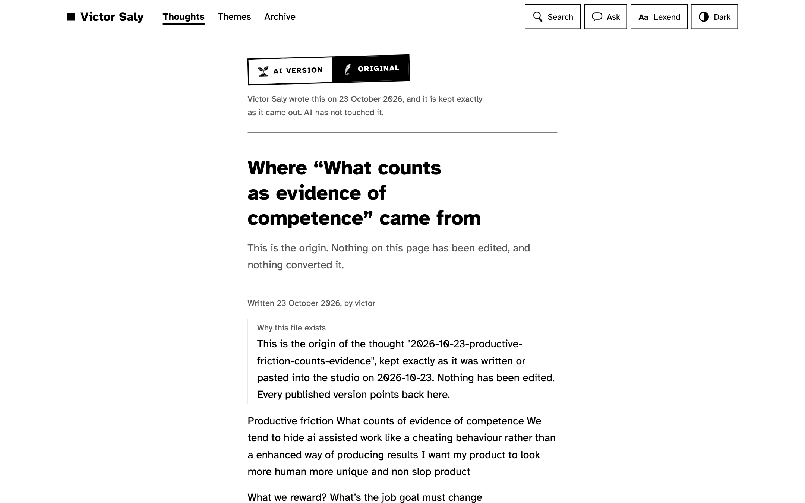
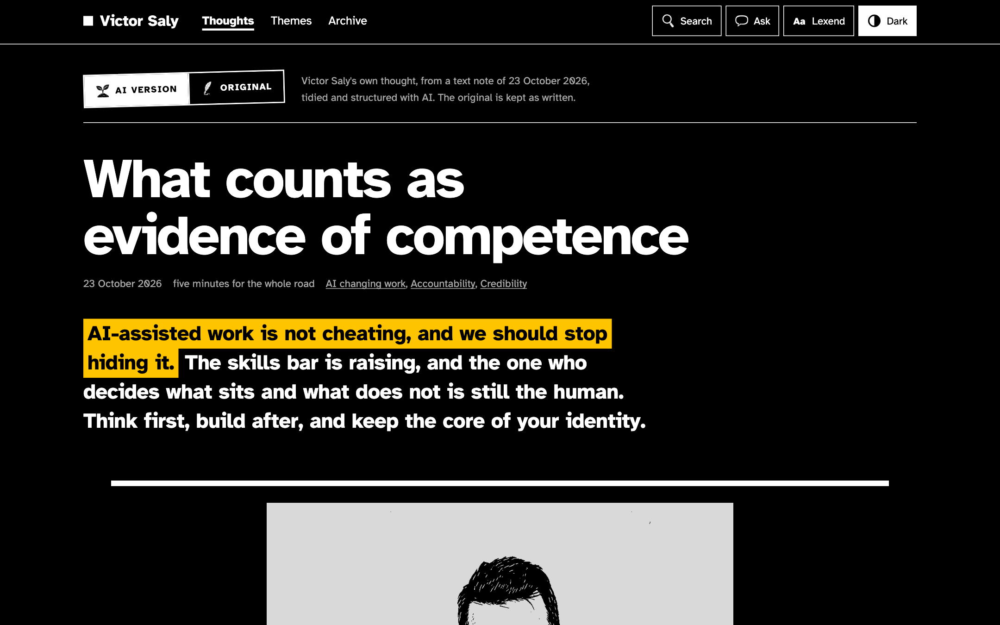
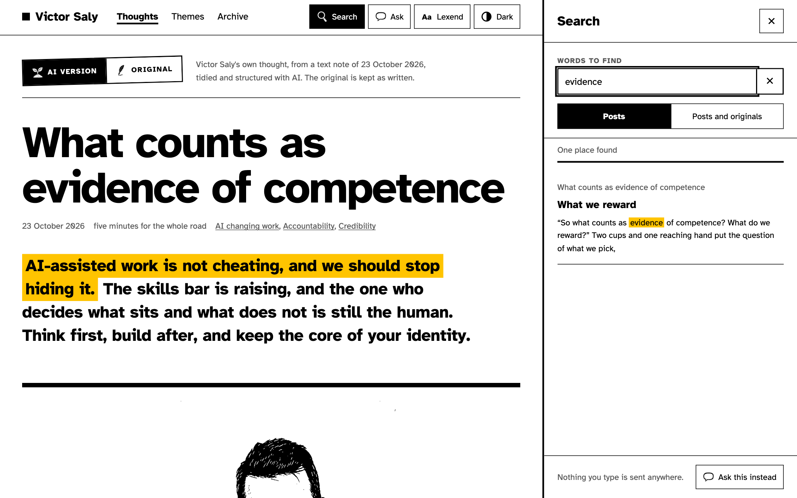
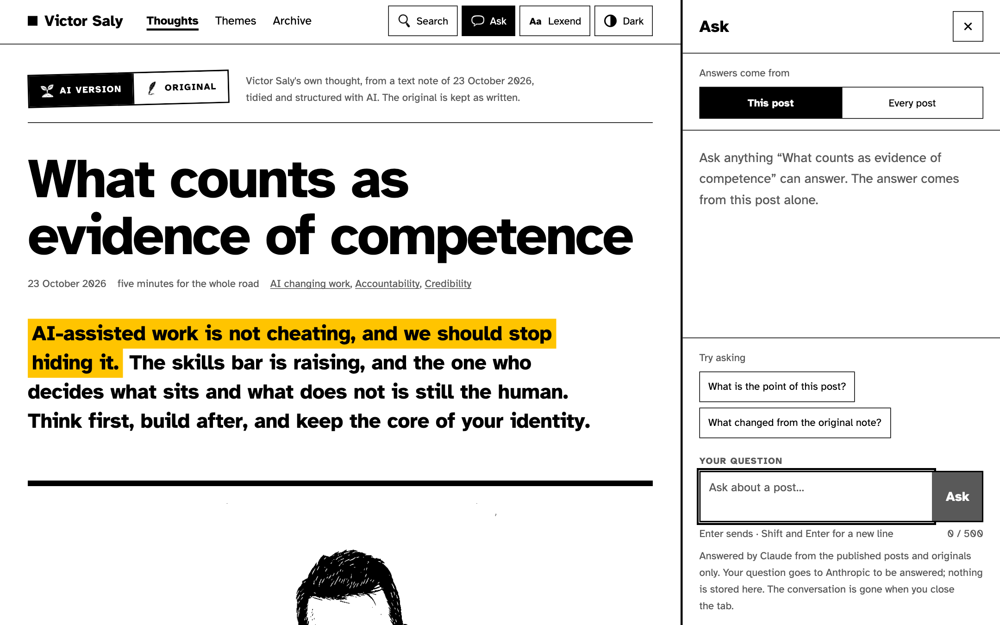
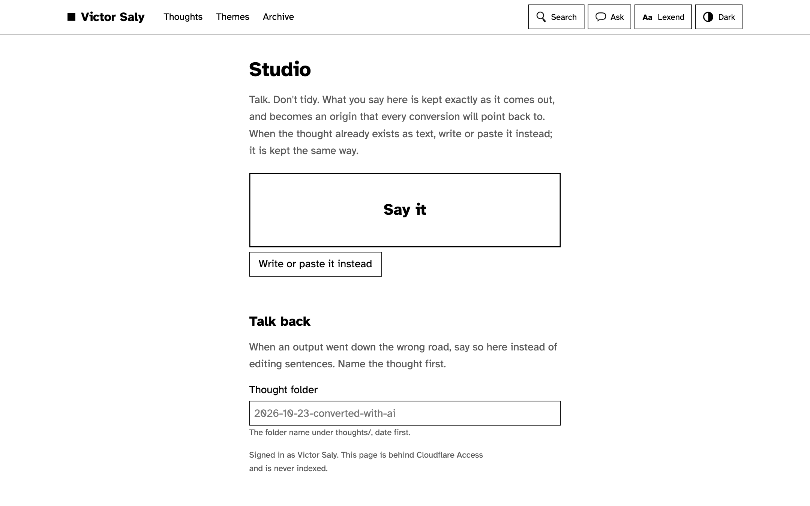
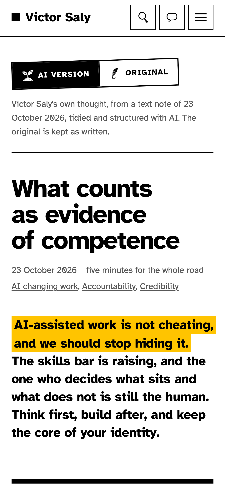

<p></p>

# Agentic blog

The engine behind **[blog.victorsaly.com](https://blog.victorsaly.com)**: a blog where every post starts as a
real thought, spoken or written, kept exactly as it came out. Agents tidy it and give it structure; a human
reads every change and merges it. Every post has a switch back to its original.

**Live blog: [blog.victorsaly.com](https://blog.victorsaly.com)**
&nbsp;·&nbsp; [Start here: the first post](https://blog.victorsaly.com/thoughts/2026-10-23-converted-with-ai)
&nbsp;·&nbsp; [Newest post](https://blog.victorsaly.com/thoughts/2026-10-23-productive-friction-counts-evidence)
&nbsp;·&nbsp; [Its original](https://blog.victorsaly.com/thoughts/2026-10-23-productive-friction-counts-evidence/origin)
&nbsp;·&nbsp; [Themes](https://blog.victorsaly.com/themes)
&nbsp;·&nbsp; [Archive](https://blog.victorsaly.com/all)
&nbsp;·&nbsp; [RSS](https://blog.victorsaly.com/rss.xml)

<p align="center"></p>

> **Talked out loud, tidied by AI.** The thought is real and stays the writer's. AI helps tidy it and give
> it structure, so anyone can say what they think freely and still publish a clear, well-documented blog.

**The idea in one minute:** [watch the pitch](site/public/media/pitch.mp4) (made from the real site by
`npm run pitch`; see [docs/audio-sources.md](docs/audio-sources.md)).

## What it offers

Victor opens the studio, presses record and talks for two minutes (or pastes a note he already wrote). That
note lands in the repo as the **origin** and is never edited again. A chain of agents reads it, asks what a
stranger would need to know, and turns it into a post a reader can take in at three depths. Each agent's
output arrives as a pull request; nothing goes live until Victor merges it.

<p align="center"></p>

Every post can be read at three depths, so a reader gets the point first and goes deeper only if they want:

| Depth | What it is |
|---|---|
| **The message** | Two or three lines at the top, the first sentence marked in marigold. |
| **The idea** | One screen in plain words, with a linocut print for each section. |
| **The road** | The whole piece, numbered source notes, and the original note behind it. |

<table>
<tr>
<td width="50%"></td>
<td width="50%"></td>
</tr>
<tr>
<td width="50%"></td>
<td width="50%"></td>
</tr>
</table>

On every page:

- **AI version | Original.** A two-way switch at the top of each post. The original is the note exactly as it
  came out, with a line saying AI has not touched it.
- **Search.** Docks beside the page, searches the posts or the posts and their originals, and marks the match.
  It runs in the browser; nothing typed is sent anywhere.
- **Ask.** A chat that answers from this post or from every post, using Claude and only the published posts
  and originals. Nothing is stored; the conversation is gone when the tab closes.
- **Lexend and Dark.** One switch changes the font from Atkinson Hyperlegible to Lexend for readers who find
  it easier; the other switches the theme. Both are remembered per browser.
- **Built for every reader.** WCAG 2.2 AA, checked with axe in CI. The keyboard reaches everything, motion
  only happens when the reader asks for it, and `prefers-reduced-motion` is respected.

<table>
<tr>
<td width="62%"></td>
<td width="38%" align="center"></td>
</tr>
</table>

The **studio** (`/studio`, behind Cloudflare Access) is where every origin begins: record, or write and paste.
**Talk back** takes a spoken or written note about an output that went down the wrong road, and the feedback
agent turns it into a rework instead of Victor editing sentences.

## How it works

```
studio: record or paste ──▶ R2 + Workers AI transcription ──▶ origin lands by pull request (never edited)
                                         │
                                         ▼
                    interview agent asks what a reader needs; Victor answers by voice
                                         │
                                         ▼
                    structure agent: message · idea · road · small ideas · themes
                                         │
      ┌──────────────┬───────────────┬───┴──────────┬──────────────┬──────────────┐
      ▼              ▼               ▼              ▼              ▼              ▼
   convert         image          diagram       citations      drilldown         seo
  (short, long,  (linocut print, (a flow, when  (what each     (wiki pages    (metadata)
   LinkedIn,      reviewed by     a section     claim rests    for books
   languages)     Claude)         earns one)    on)            and people)
                                         │
                                         ▼
                    safety + security can hold anything that should not leave
                                         │
                                         ▼
                    publish agent assembles the pull request ──▶ Victor reads, fixes, merges ──▶ live
```

- **Agents:** one job each, each a folder in [`agents/`](agents/) with a `PROMPT.md` (the behaviour,
  why first) and an `index.ts` (plumbing only). Every agent reads [`profile.md`](profile.md) first and writes
  towards the blogger, not towards the average of the internet. The roster is in [agents/README.md](agents/README.md).
- **Triggers:** an agent runs when a pull request gets the label `agent:<name>`, by hand from the Actions tab,
  or on a schedule (the weekly security check). Its output becomes a commit on that pull request.
- **Guardrails:** the runner refuses to write anything under `origin/`; every file must carry a `why:` in its
  front matter or the runner and the build both fail; an agent adds no facts the blogger did not say, and what
  it cuts or adds goes in the why; `main` is protected and nothing publishes without a human merge.
- **Models:** Claude for the reasoning agents, for reviewing every drawing and for the reader chat; Workers AI
  for transcription; OpenAI's image model for the linocut prints, with Workers AI as the fallback.
- **The road:** each thought folder keeps `road.md`, which records which agents ran, in which order, with
  which prompts, so every post can show how it was made.

## Tech stack

Astro 7 with React islands, TypeScript strict · Markdown with YAML front matter, read by Astro content
collections · Pagefind for search · Cloudflare Workers with static assets, R2 for audio, Workers AI,
Cloudflare Access · Anthropic Claude · OpenAI images · GitHub Actions · Vitest, Playwright and axe.

## Run locally

Needs Node 22.23.4 or later (see `.node-version`).

```bash
npm install            # installs the root, site and agents workspaces
npm run dev            # Astro dev server at http://localhost:4321
npm run build          # checks every why, then builds into site/dist
npm run lint           # ESLint + Prettier check
npm run typecheck      # tsc --noEmit for site and agents
npm run test           # Vitest
npm run check:why      # every content and agent file has a why
```

Run one agent against one thought. The runner reads its keys from the shell, not from a file, so copy
`.env.example` to `.env`, fill it in, and load it into the shell first:

```bash
set -a; source .env; set +a     # exports every line of .env into this shell
npm run agent -- interview 2026-10-23-converted-with-ai
```

`.env` needs `ANTHROPIC_API_KEY`. For drawings add `OPENAI_API_KEY` (and optionally `OPENAI_IMAGE_MODEL`), or
`CLOUDFLARE_ACCOUNT_ID` and `CLOUDFLARE_AI_TOKEN` for the Workers AI fallback. Without either, the image agent
writes `image/prompt.md` and stops; it also needs `ffmpeg` on the path.

Run the built site together with the edge functions (upload, transcription, Ask), with local R2 and AI bindings:

```bash
npm run worker:dev --workspace site
```

The Worker does not read the root `.env`; wrangler reads `site/.dev.vars` instead. Copy
`site/.dev.vars.example` to `site/.dev.vars` and fill in `ANTHROPIC_API_KEY` (Ask answers 503 without it),
`GITHUB_TOKEN` (a fine-grained token with Contents read and write on this repo, used to land origins) and
`DEV_SKIP_ACCESS=1` to skip the Access check locally. In production the two keys are Worker secrets
(`npx wrangler secret put …` from `site/`).

The Cloudflare setup (R2 bucket, secrets, custom domain, Access) is written out step by step in
[site/README.md](site/README.md).

More detail: [the agents](agents/README.md) · [the site](site/README.md) · [the product brief](site/PRODUCT.md)
· [skills used to build it](docs/skills.md) · [working rules for people and agents](CLAUDE.md) ·
[who the blogger is](profile.md) · [site settings](settings.yml).

## Deploy and CI

| Workflow | When | What it does |
|---|---|---|
| [CI](.github/workflows/ci.yml) | every pull request and push | why check, lint, types, tests, build, then axe on the built pages |
| [Deploy](.github/workflows/deploy.yml) | push to `main` | builds and deploys the Worker to blog.victorsaly.com |
| [New origin](.github/workflows/origin.yml) | the studio sends a note | lands the origin in its thought folder as a pull request |
| [Agents](.github/workflows/agents.yml) | label `agent:<name>`, or by hand | runs one agent on one thought and commits its output |
| [Security weekly](.github/workflows/security-weekly.yml) | weekly | audits dependencies and opens an issue when something needs patching |
| [Format](.github/workflows/format.yml), [Lockfile](.github/workflows/lockfile.yml) | by hand, on dependency changes | keep Prettier formatting and `package-lock.json` in step |

## Project structure

```
profile.md        who the blogger is and how they talk; every agent reads it first
settings.yml      domain, languages, themes, the index switch, image style, models
thoughts/         one folder per thought
  <date-slug>/
    origin/       the note as it came out (+ audio key in R2), answers; append-only
    structure.md  message, idea, road, small ideas with themes, why
    versions/     short.md, long.md, linkedin.md, <lang>.md; each names what it came from and why
    image/        the prints and their prompts
    diagram/      diagrams the site draws
    sources.md    citations, each reviewed
    feedback/     notes about the output, dated
    road.md       which agents ran, in which order, with which prompts
wiki/             drill-down pages for books and people
agents/           one folder per agent: PROMPT.md + index.ts; run.ts is the runner
site/             the Astro app
  src/            pages, components, React islands, tokens.css (every colour and size)
  functions/      edge functions in the Worker: upload, transcribe, audio, origin, ask
scripts/          repo checks: the why check, content schema, axe, landing an origin
docs/             skills.md and the images in this README
.github/          CI, deploy, agent workflows
```

## Design

Black on white, white on black. One colour, marigold: on a post it marks the message, once; on a list page it
marks each post's title; in search it marks the match. Drawings are linocut prints; in dark mode they stay ink
on paper, dimmed, never inverted. No shadows, gradients or cards: structure comes from spacing and ink rules in
three weights. Atkinson Hyperlegible at 19px, line height 1.6, about 70 characters a line. The full rules are in
[CLAUDE.md](CLAUDE.md) and [site/PRODUCT.md](site/PRODUCT.md).

## Credits

- Writing, voice notes and every merge: [Victor Saly](https://victorsaly.com).
- Fonts: [Atkinson Hyperlegible](https://www.brailleinstitute.org/freefont/) (Braille Institute) and
  [Lexend](https://www.lexend.com/), both under the SIL Open Font Licence.
- Models: Anthropic Claude, Cloudflare Workers AI, OpenAI images.

## Licence

Code: [MIT](LICENSE). Content under `thoughts/` and `wiki/`: all rights reserved until a licence is chosen
(see `settings.yml`).
